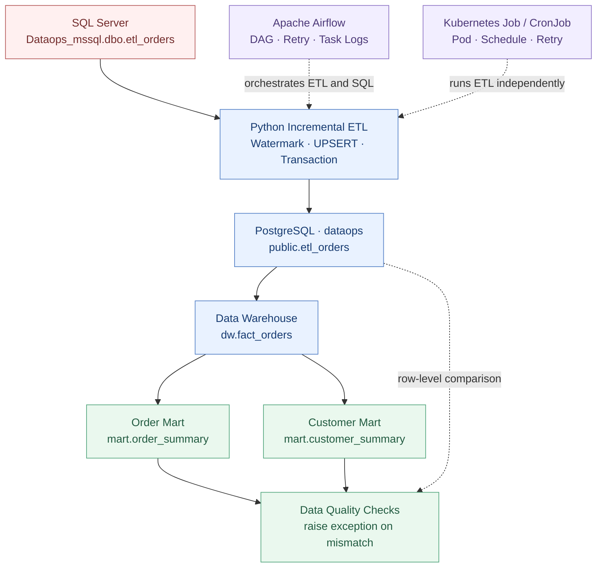
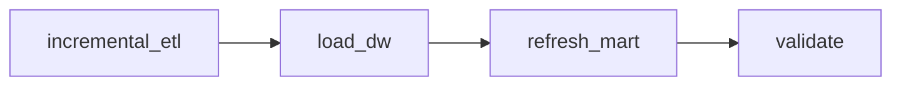

<div align="center">

# DataOps Pipeline

### End-to-End Data Engineering Pipeline

**MSSQL → Python ETL → PostgreSQL → Data Warehouse → Data Mart**

운영 데이터의 증분 적재부터 워크플로 자동화, 장애 복구, 데이터 정합성 검증까지 구현한 개인 DataOps 프로젝트입니다.

<p>
  
  
  
  
  
  
</p>

**Incremental ETL · Data Integrity · Airflow · Kubernetes · DW / Data Mart · Failure Recovery**

</div>

---

## 📌 Project Overview

Microsoft SQL Server의 주문 데이터를 Python으로 추출해 PostgreSQL에 **Watermark 기반 증분 적재**하고, 이를 분석용 Data Warehouse와 Data Mart로 가공합니다.

단순히 데이터를 이동시키는 데 그치지 않고, **반복 실행 가능한 적재 구조, 트랜잭션 기반 복구, 자동 재시도, 데이터 품질 검증**을 구현하는 데 초점을 맞췄습니다. 동일한 증분 ETL 이미지를 **Docker Compose, Apache Airflow, Kubernetes Job/CronJob** 환경에서 실행해 보았습니다.

| 영역 | 주요 구현 |
| :-- | :-- |
| **Data Ingestion** | `updated_at` 기반 증분 추출, PostgreSQL UPSERT |
| **Reliability** | ROLLBACK, Watermark 유지, 오류 로그, 재시도 |
| **Orchestration** | Apache Airflow DAG, 의존성·스케줄·실행 상태 관리 |
| **Data Modeling** | 주문 Fact 테이블, 전체/고객별 Data Mart |
| **Data Quality** | 원본 복제본–DW 행별 비교, DW–Mart 집계 검증 |
| **Infrastructure** | Docker Compose 기반 PostgreSQL·Airflow, Kubernetes Job/CronJob 기반 ETL 실행 |

## 🏗️ System Architecture



### End-to-End DAG



> 각 Airflow Task는 독립적으로 실행되고 성공 시 다음 단계로 넘어갑니다. Kubernetes Job/CronJob은 같은 Python ETL을 **Airflow와 별도로** 실행하는 실습입니다. 두 오케스트레이터를 직접 연동한 구성은 아닙니다.

## 🛠️ Tech Stack

| Category | Technology |
| :-- | :-- |
| Source Database | Microsoft SQL Server Developer |
| Target Database | PostgreSQL 17 |
| ETL | Python, pyodbc, psycopg |
| Workflow Orchestration | Apache Airflow 3.3.2 (CeleryExecutor) |
| Containers / Batch Runtime | Docker, Docker Compose, Kubernetes (Docker Desktop local cluster) |
| Development | Windows 11, WSL2, Linux, PowerShell |
| Database Tools | SSMS, DBeaver |

## ✨ Key Implementations

### 01 — Incremental ETL

- `public.etl_watermarks`의 마지막 처리 시각으로 MSSQL 변경 대상을 추출합니다.
- `ON CONFLICT DO UPDATE`를 사용해 PostgreSQL에 UPSERT합니다.
- `IS DISTINCT FROM` 조건으로 값이 바뀌지 않은 행의 불필요한 UPDATE를 줄입니다.
- 적재와 검증, Watermark 갱신을 트랜잭션으로 처리합니다.

### 02 — Failure Handling & Recovery

- `ETL_FAIL_AFTER_LOAD` 환경 변수로 적재 중 오류를 의도적으로 발생시켰습니다.
- PostgreSQL **ROLLBACK** 후 신규 주문 및 Watermark가 유지되는지 확인했습니다.
- Python Logging에 오류 메시지와 Traceback을 기록합니다.
- Airflow Task가 실패를 감지한 후 자동 재시도하여 복구되는 과정을 검증했습니다.

### 03 — Data Warehouse & Mart

| Layer | Table | Description |
| :-- | :-- | :-- |
| Replication | `public.etl_orders` | MSSQL 주문 데이터 복제 |
| DW | `dw.fact_orders` | 주문 1건당 1행인 Fact 테이블 |
| Mart | `mart.order_summary` | 전체 주문 건수, 합계, 평균 |
| Mart | `mart.customer_summary` | 고객 이름별 주문 통계 |

### 04 — Data Quality Validation

- `public.etl_orders` ↔ `dw.fact_orders`: 누락된 주문 및 값 불일치 확인
- DW ↔ Order Mart: 총 주문 건수·금액·평균 비교
- DW ↔ Customer Mart: 고객별 집계 및 누락 여부 비교
- 불일치 시 SQL의 `RAISE EXCEPTION`으로 Task가 실패하도록 구성

### 05 — Kubernetes Batch Execution

- `dataops` Namespace에 일회성 ETL **Job**을 배포해 MSSQL → PostgreSQL 증분 적재를 실행했습니다.
- `CronJob`을 `Asia/Seoul` 기준 **5분 주기**로 설정하고 반복 실행을 검증했습니다.
- `concurrencyPolicy: Forbid`로 **동일 CronJob 내부**의 중복 실행을 제한했습니다.
- 계정 및 비밀번호는 Kubernetes **Secret 참조(`secretKeyRef`)**로 전달합니다.
- `OnFailure` 컨테이너 재시작 및 실제 ETL 강제 실패 후 **ROLLBACK → 정상 재실행**을 각각 검증했습니다.

## 🔄 Airflow DAGs

| DAG | Purpose | Trigger |
| :-- | :-- | :-- |
| `dataops_first_dag` | TaskFlow API 학습 | Manual |
| `dataops_incremental_etl` | MSSQL → PostgreSQL 증분 ETL | Cron `*/5 * * * *` (실습용) |
| `dataops_etl_retry_lab` | 실패 및 자동 재시도 실험 | Manual |
| **`dataops_end_to_end_pipeline`** | **ETL → DW → Mart → Validation** | **Manual** |

자동 스케줄링과 재시도는 개별 학습 DAG에서 검증했으며, 통합 End-to-End DAG는 현재 `schedule=None`인 수동 실행 구성입니다.

## ☸️ Kubernetes Jobs & CronJobs

Airflow 워크플로와는 **별도로** Kubernetes의 배치 실행·스케줄·재시도 기능을 실습했습니다. 기존 Docker ETL 이미지(`dataops-etl:dev`)와 Python 코드를 재사용했습니다.

| Manifest | Purpose | Result |
| :-- | :-- | :-- |
| [00_namespace.yaml](k8s/00_namespace.yaml) | 전용 `dataops` Namespace 생성 | 생성 확인 |
| [01_hello_job.yaml](k8s/jobs/01_hello_job.yaml) | Job → Pod 생성 및 정상 종료 | `Completed` |
| [02_network_check_job.yaml](k8s/jobs/02_network_check_job.yaml) | Pod → MSSQL/PostgreSQL TCP 연결 확인 | 연결 확인 |
| [03_incremental_etl_job.yaml](k8s/jobs/03_incremental_etl_job.yaml) | Kubernetes에서 Python 증분 ETL 실행 | `Completed` |
| [04_incremental_etl_cronjob.yaml](k8s/cronjobs/04_incremental_etl_cronjob.yaml) | 5분 주기 ETL, 중복 실행 제한 | 자동 실행 확인 |
| [05_retry_recovery_job.yaml](k8s/jobs/05_retry_recovery_job.yaml) | 첫 실행 실패 → 같은 Pod에서 재시작 | `RESTARTS=1`, 성공 |
| [06_etl_rollback_test_job.yaml](k8s/jobs/06_etl_rollback_test_job.yaml) | 실제 적재 이후 강제 오류·트랜잭션 취소 | 의도적 `Failed` |
| [07_etl_recovery_job.yaml](k8s/jobs/07_etl_recovery_job.yaml) | 강제 장애 해제 후 ETL 재실행 | `Completed` |

> **실습 안전 설정:** CronJob YAML은 `suspend: true`로 저장했습니다. 자동 실행을 테스트할 때만 일시적으로 활성화했고, 테스트 후 다시 중지했습니다. `concurrencyPolicy: Forbid`는 **동일 CronJob의 실행 중복만** 방지하며, 별도의 Airflow DAG·Job까지 제한하지는 않습니다.

### Recovery Lab — 실제 데이터 ROLLBACK 검증

테스트 주문 `1013`(금액 `45,000`)을 MSSQL에 생성한 뒤, Kubernetes Job에서 `ETL_FAIL_AFTER_LOAD=1`을 설정해 PostgreSQL UPSERT 직후 오류를 발생시켰습니다.

| 검증 항목 | 강제 장애 Job | 정상 복구 Job |
| :-- | :-- | :-- |
| Kubernetes 상태 | `Failed` (의도한 결과) | `Completed` |
| PostgreSQL 주문 1013 | **0건** (ROLLBACK) | **1건** |
| Watermark | **이전 값 유지** | 정상 갱신 |
| ETL 결과 | 오류 로그 및 비정상 종료 | 정상 적재 및 종료 |

- [MSSQL 테스트 데이터 SQL](sql/mssql/08_k8s_rollback_test.sql)
- [강제 장애 Job](k8s/jobs/06_etl_rollback_test_job.yaml)
- [정상 복구 Job](k8s/jobs/07_etl_recovery_job.yaml)

이는 **Kubernetes가 DB 트랜잭션을 ROLLBACK하는 것**이 아니라, **Python ETL과 PostgreSQL의 트랜잭션 처리로 데이터 정합성을 보호하고 Kubernetes Job을 다시 실행해 복구한 것**입니다.

### Troubleshooting — `ErrImageNeverPull`

**증상:** Docker 호스트에는 `dataops-etl:dev` 이미지가 있었지만 Kubernetes Pod는 `ErrImageNeverPull`로 시작하지 못했습니다.

**원인:** 로컬 Docker 이미지와 Docker Desktop Kubernetes(kind 방식) 노드의 **containerd 이미지 저장소가 분리**되어 있었습니다. Job 설정의 `imagePullPolicy: Never`는 Kubernetes 노드에 이미지가 없을 때 자동으로 이미지를 내려받지 않습니다.

**해결:** Windows PowerShell에서 바이너리 TAR 스트림을 Node의 containerd 이미지 저장소(`k8s.io`)로 직접 전달했습니다. 아래 명령은 해당 로컬 Docker Desktop 환경에서 사용한 방식입니다.

```powershell
# 기존 ETL 이미지 빌드
docker compose build etl

# Docker 이미지를 Kubernetes 노드의 containerd로 바로 전달
# CMD의 바이너리 파이프 사용 (PowerShell 텍스트 파이프 변환 방지)
cmd.exe /d /c 'docker image save --platform linux/amd64 dataops-etl:dev | docker exec -i desktop-control-plane ctr -n k8s.io images import -'

# Kubernetes 노드 이미지 저장소에서 등록 확인
docker exec desktop-control-plane crictl images
```

**결과:** 이미지 등록 확인 후 실패한 Job을 새로 생성하여 실제 ETL이 정상 완료됐습니다.

> `desktop-control-plane`은 이번 로컬 클러스터의 노드 이름입니다. 다른 클러스터에서는 이미지 로딩 방법과 노드 이름이 다를 수 있습니다. 실서비스에서는 일반적으로 이미지 레지스트리를 사용합니다.


## 📂 Repository Structure

```text
DataOpsPipeline/
├── airflow/
│   ├── dags/
│   │   ├── dataops_first_dag.py
│   │   ├── dataops_incremental_etl.py
│   │   ├── dataops_etl_retry_lab.py
│   │   └── dataops_end_to_end_pipeline.py
│   ├── Dockerfile.worker
│   ├── docker-compose.yaml
│   └── .env.example
├── etl/
│   ├── mssql_to_postgres.py
│   ├── mssql_to_postgres_incremental.py
│   ├── run_postgres_sql.py
│   └── test_mssql_docker.py
├── k8s/
│   ├── 00_namespace.yaml
│   ├── jobs/                      # Job / 재시도 / 장애 복구
│   └── cronjobs/                  # 5분 주기 ETL
├── sql/
│   ├── mssql/                # Source schema and test data
│   └── postgresql/           # DW, Mart, data validation
├── Dockerfile
├── docker-compose.yaml
├── requirements.txt
├── .env.example
└── README.md
```

## 🚀 Running Locally

이 저장소는 **로컬 실습 환경을 기준으로 구성**했습니다. 실행 전 Windows SQL Server(`Dataops_mssql`), ETL용 SQL 로그인, 대상 PostgreSQL 스키마·테이블, Docker Desktop 및 WSL2가 준비되어야 합니다. SQL 스크립트는 `sql/` 폴더에 있습니다.

**1. Clone & configure**

```powershell
# 원격 저장소를 로컬에 복제
git clone https://github.com/hanmj97/DataOpsPipeline.git

# 프로젝트 폴더로 이동
cd DataOpsPipeline

# 샘플 환경 설정 복사 후 실제 접속 정보 입력
Copy-Item .env.example .env
notepad .env
```

**2. Prepare Docker resources (최초 1회)**

```powershell
# Airflow와 데이터 PostgreSQL이 공유할 네트워크 생성
docker network create dataops_airflow_link

# 기존 Compose가 사용하는 PostgreSQL 데이터 볼륨 생성
docker volume create dataops_pgdata

# PostgreSQL 실행
docker compose up -d postgres
```

이미 리소스가 존재한다면 생성 명령은 건너뛰세요.

**3. Initialize & start Airflow**

```powershell
# Airflow 프로젝트로 이동
cd airflow

# Airflow 환경 변수 파일 생성
Copy-Item .env.example .env

# AIRFLOW_UID 및 FERNET_KEY 등 설정
notepad .env

# 최초 메타데이터 초기화
docker compose up airflow-init

# Airflow 서비스 백그라운드 실행
docker compose up -d

# 상태 확인
docker compose ps
```

**4. Run the Airflow pipeline**

Airflow Web UI: **http://localhost:8080**

`dataops_end_to_end_pipeline` DAG를 선택해 수동으로 Trigger합니다. 실행 순서는 아래와 같습니다.

```text
incremental_etl → load_dw → refresh_mart → validate
```

> 참고: 위 명령어만으로 모든 데이터베이스와 테이블, 권한이 자동 생성되지는 않습니다. Docker 네트워크, SQL Server 연결, ETL 계정 권한, 데이터베이스 초기 스키마가 실제 환경과 맞아야 합니다.

**5. (Optional) Run with Kubernetes**

Docker Desktop Kubernetes 클러스터에서 진행하는 별도 실습입니다. **(1)** `dataops-etl:dev` 이미지를 클러스터 노드에 등록하고, **(2)** 실제 DB 정보를 담은 `dataops-etl-db` Secret을 로컬 클러스터에 생성한 다음 아래 파일을 적용하세요. Secret의 실제 값은 저장소에 포함하지 않습니다.

```powershell
# 프로젝트 루트에서 실행: Namespace 생성
kubectl apply -f .\k8s\00_namespace.yaml

# 사전 준비: Kubernetes 노드 이미지 등록 및 dataops-etl-db Secret 생성
# 일회성 증분 ETL Job 배포 (완료된 Job은 apply만으로 재실행되지 않음)
kubectl apply -f .\k8s\jobs\03_incremental_etl_job.yaml

# Job 상태 및 실행 로그 확인
kubectl get jobs -n dataops
kubectl logs -n dataops job/dataops-incremental-etl

# CronJob은 suspend=true로 등록되어 자동 실행되지 않음
kubectl apply -f .\k8s\cronjobs\04_incremental_etl_cronjob.yaml
kubectl get cronjobs -n dataops
```

> 장애 테스트용 `06_etl_rollback_test_job.yaml`은 **의도적으로 실패하며**, 실제 DB에 접근합니다. 운영 DB에서 실행하지 마세요. 본 프로젝트의 Kubernetes YAML과 Docker Compose 설정은 로컬 실습 환경에 맞춰져 있습니다.

## ✅ Validation Scripts

| File | Purpose |
| :-- | :-- |
| [05_load_dw_fact_orders.sql](sql/postgresql/05_load_dw_fact_orders.sql) | DW UPSERT 및 행별 정합성 |
| [07_refresh_data_mart.sql](sql/postgresql/07_refresh_data_mart.sql) | 전체/고객별 마트 갱신 |
| [08_validate_data_mart.sql](sql/postgresql/08_validate_data_mart.sql) | 불일치 시 SQL 예외 발생 |
| [09_validate_end_to_end_pipeline.sql](sql/postgresql/09_validate_end_to_end_pipeline.sql) | 통합 테스트 결과 조회 |

## ⚠️ Limitations & Next Steps

- `updated_at` 기반 Watermark는 CDC가 아니며, 지연 커밋 변경을 완전히 보장하지 않습니다.
- MSSQL 원본의 `DELETE`는 현재 자동 동기화하지 않습니다.
- 고객별 Mart는 실습용으로 `customer_name`을 사용합니다. 실제 서비스에서는 고유 고객 ID가 필요합니다.
- SQL Server의 `TrustServerCertificate=yes`와 로컬 환경 변수 구성은 실습용입니다. 운영 환경에는 인증서 검증과 Secret 관리가 필요합니다.
- Kubernetes Job / CronJob 및 실패 복구 실습은 완료했습니다. **후속 개선 과제:** 자동화 테스트·통합 모니터링, Kubernetes 이미지 레지스트리와 배포 자동화, CDC 및 데이터 식별자 개선입니다.

---

<div align="center">

**Data Engineering · Database Reliability · Workflow Automation**

Hands-on DataOps Portfolio Project

</div>
