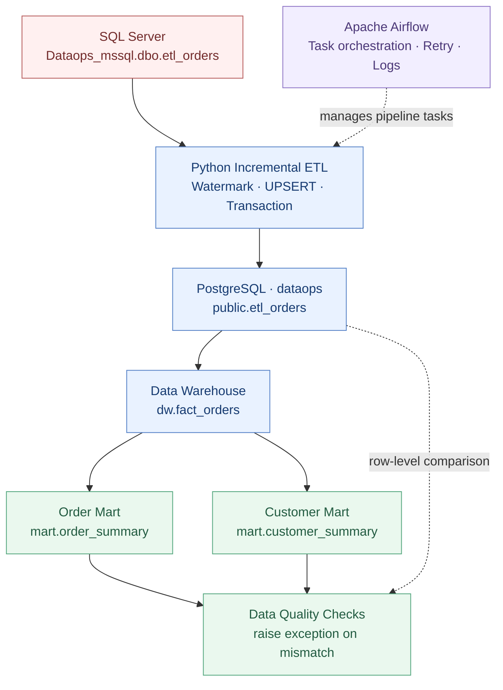
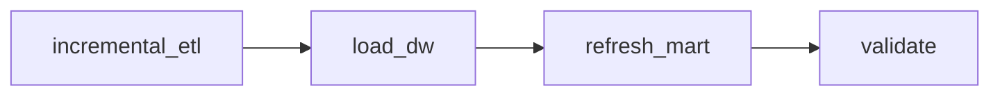

<div align="center">

# DataOps Pipeline

### End-to-End Data Engineering Pipeline

**MSSQL → Python ETL → PostgreSQL → Data Warehouse → Data Mart**

운영 데이터의 증분 적재부터 워크플로 자동화, 장애 복구, 데이터 정합성 검증까지 구현한 개인 DataOps 프로젝트입니다.

<p>
  
  
  
  
  
</p>

**Incremental ETL · Data Integrity · Airflow · DW / Data Mart · Failure Recovery**

</div>

---

## 📌 Project Overview

Microsoft SQL Server의 주문 데이터를 Python으로 추출해 PostgreSQL에 **Watermark 기반 증분 적재**하고, 이를 분석용 Data Warehouse와 Data Mart로 가공합니다.

단순히 데이터를 이동시키는 데 그치지 않고, **반복 실행 가능한 적재 구조, 트랜잭션 기반 복구, 자동 재시도, 데이터 품질 검증**을 구현하는 데 초점을 맞췄습니다.

| 영역 | 주요 구현 |
| :-- | :-- |
| **Data Ingestion** | `updated_at` 기반 증분 추출, PostgreSQL UPSERT |
| **Reliability** | ROLLBACK, Watermark 유지, 오류 로그, 재시도 |
| **Orchestration** | Apache Airflow DAG, 의존성·스케줄·실행 상태 관리 |
| **Data Modeling** | 주문 Fact 테이블, 전체/고객별 Data Mart |
| **Data Quality** | 원본 복제본–DW 행별 비교, DW–Mart 집계 검증 |
| **Infrastructure** | Docker Compose 기반 PostgreSQL 및 Airflow 실행 |

## 🏗️ System Architecture



### End-to-End DAG



> 각 Task는 독립적으로 실행되고 성공 시 다음 단계로 넘어갑니다. 전체 작업이 하나의 데이터베이스 트랜잭션으로 묶이는 구조는 아닙니다.

## 🛠️ Tech Stack

| Category | Technology |
| :-- | :-- |
| Source Database | Microsoft SQL Server Developer |
| Target Database | PostgreSQL 17 |
| ETL | Python, pyodbc, psycopg |
| Workflow Orchestration | Apache Airflow 3.3.2 (CeleryExecutor) |
| Containers | Docker, Docker Compose |
| Development | Windows 11, WSL2, Linux, PowerShell |
| Database Tools | SSMS, DBeaver |

## ✨ Key Implementations

### 01 — Incremental ETL

- `public.etl_watermarks`의 마지막 처리 시각으로 MSSQL 변경 대상을 추출합니다.
- `ON CONFLICT DO UPDATE`를 사용해 PostgreSQL에 UPSERT합니다.
- `IS DISTINCT FROM` 조건으로 값이 바뀌지 않은 행의 불필요한 UPDATE를 줄입니다.
- 적재와 검증, Watermark 갱신을 트랜잭션으로 처리합니다.

### 02 — Failure Handling & Recovery

- `ETL_FAIL_AFTER_LOAD` 환경 변수로 적재 중 오류를 의도적으로 발생시켰습니다.
- PostgreSQL **ROLLBACK** 후 신규 주문 및 Watermark가 유지되는지 확인했습니다.
- Python Logging에 오류 메시지와 Traceback을 기록합니다.
- Airflow Task가 실패를 감지한 후 자동 재시도하여 복구되는 과정을 검증했습니다.

### 03 — Data Warehouse & Mart

| Layer | Table | Description |
| :-- | :-- | :-- |
| Replication | `public.etl_orders` | MSSQL 주문 데이터 복제 |
| DW | `dw.fact_orders` | 주문 1건당 1행인 Fact 테이블 |
| Mart | `mart.order_summary` | 전체 주문 건수, 합계, 평균 |
| Mart | `mart.customer_summary` | 고객 이름별 주문 통계 |

### 04 — Data Quality Validation

- `public.etl_orders` ↔ `dw.fact_orders`: 누락된 주문 및 값 불일치 확인
- DW ↔ Order Mart: 총 주문 건수·금액·평균 비교
- DW ↔ Customer Mart: 고객별 집계 및 누락 여부 비교
- 불일치 시 SQL의 `RAISE EXCEPTION`으로 Task가 실패하도록 구성

## 🔄 Airflow DAGs

| DAG | Purpose | Trigger |
| :-- | :-- | :-- |
| `dataops_first_dag` | TaskFlow API 학습 | Manual |
| `dataops_incremental_etl` | MSSQL → PostgreSQL 증분 ETL | Cron `*/5 * * * *` (실습용) |
| `dataops_etl_retry_lab` | 실패 및 자동 재시도 실험 | Manual |
| **`dataops_end_to_end_pipeline`** | **ETL → DW → Mart → Validation** | **Manual** |

자동 스케줄링과 재시도는 개별 학습 DAG에서 검증했으며, 통합 End-to-End DAG는 현재 `schedule=None`인 수동 실행 구성입니다.

## 📂 Repository Structure

```text
DataOpsPipeline/
├── airflow/
│   ├── dags/
│   │   ├── dataops_first_dag.py
│   │   ├── dataops_incremental_etl.py
│   │   ├── dataops_etl_retry_lab.py
│   │   └── dataops_end_to_end_pipeline.py
│   ├── Dockerfile.worker
│   ├── docker-compose.yaml
│   └── .env.example
├── etl/
│   ├── mssql_to_postgres.py
│   ├── mssql_to_postgres_incremental.py
│   ├── run_postgres_sql.py
│   └── test_mssql_docker.py
├── sql/
│   ├── mssql/                # Source schema and test data
│   └── postgresql/           # DW, Mart, data validation
├── Dockerfile
├── docker-compose.yaml
├── requirements.txt
├── .env.example
└── README.md
```

## 🚀 Running Locally

이 저장소는 **로컬 실습 환경을 기준으로 구성**했습니다. 실행 전 Windows SQL Server(`Dataops_mssql`), ETL용 SQL 로그인, 대상 PostgreSQL 스키마·테이블, Docker Desktop 및 WSL2가 준비되어야 합니다. SQL 스크립트는 `sql/` 폴더에 있습니다.

**1. Clone & configure**

```powershell
# 원격 저장소를 로컬에 복제
git clone https://github.com/hanmj97/DataOpsPipeline.git

# 프로젝트 폴더로 이동
cd DataOpsPipeline

# 샘플 환경 설정 복사 후 실제 접속 정보 입력
Copy-Item .env.example .env
notepad .env
```

**2. Prepare Docker resources (최초 1회)**

```powershell
# Airflow와 데이터 PostgreSQL이 공유할 네트워크 생성
docker network create dataops_airflow_link

# 기존 Compose가 사용하는 PostgreSQL 데이터 볼륨 생성
docker volume create dataops_pgdata

# PostgreSQL 실행
docker compose up -d postgres
```

이미 리소스가 존재한다면 생성 명령은 건너뛰세요.

**3. Initialize & start Airflow**

```powershell
# Airflow 프로젝트로 이동
cd airflow

# Airflow 환경 변수 파일 생성
Copy-Item .env.example .env

# AIRFLOW_UID 및 FERNET_KEY 등 설정
notepad .env

# 최초 메타데이터 초기화
docker compose up airflow-init

# Airflow 서비스 백그라운드 실행
docker compose up -d

# 상태 확인
docker compose ps
```

**4. Run the pipeline**

Airflow Web UI: **http://localhost:8080**

`dataops_end_to_end_pipeline` DAG를 선택해 수동으로 Trigger합니다. 실행 순서는 아래와 같습니다.

```text
incremental_etl → load_dw → refresh_mart → validate
```

> 참고: 위 명령어만으로 모든 데이터베이스와 테이블, 권한이 자동 생성되지는 않습니다. Docker 네트워크, SQL Server 연결, ETL 계정 권한, 데이터베이스 초기 스키마가 실제 환경과 맞아야 합니다.

## ✅ Validation Scripts

| File | Purpose |
| :-- | :-- |
| [05_load_dw_fact_orders.sql](sql/postgresql/05_load_dw_fact_orders.sql) | DW UPSERT 및 행별 정합성 |
| [07_refresh_data_mart.sql](sql/postgresql/07_refresh_data_mart.sql) | 전체/고객별 마트 갱신 |
| [08_validate_data_mart.sql](sql/postgresql/08_validate_data_mart.sql) | 불일치 시 SQL 예외 발생 |
| [09_validate_end_to_end_pipeline.sql](sql/postgresql/09_validate_end_to_end_pipeline.sql) | 통합 테스트 결과 조회 |

## ⚠️ Limitations & Next Steps

- `updated_at` 기반 Watermark는 CDC가 아니며, 지연 커밋 변경을 완전히 보장하지 않습니다.
- MSSQL 원본의 `DELETE`는 현재 자동 동기화하지 않습니다.
- 고객별 Mart는 실습용으로 `customer_name`을 사용합니다. 실제 서비스에서는 고유 고객 ID가 필요합니다.
- SQL Server의 `TrustServerCertificate=yes`와 로컬 환경 변수 구성은 실습용입니다. 운영 환경에는 인증서 검증과 Secret 관리가 필요합니다.
- Kubernetes Job / CronJob, 파이프라인 테스트 자동화, 모니터링 고도화는 후속 실습 계획입니다.

---

<div align="center">

**Data Engineering · Database Reliability · Workflow Automation**

Hands-on DataOps Portfolio Project

</div>
